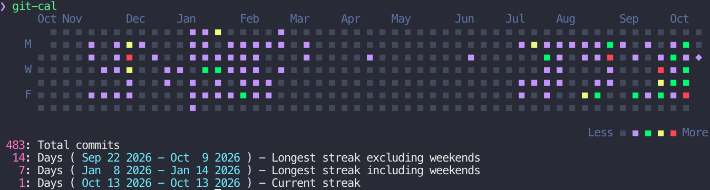

#+TITLE: git-cal

GitHub-style commit calendar in the terminal, with the Dracula color theme.
A single-file Python port of [[https://github.com/k4rthik/git-cal][k4rthik/git-cal]]. No dependencies beyond Python 3 and git.

* Install

#+begin_src sh
git clone https://github.com/avatar-lavventura/git-cal
cp git-cal/git-cal ~/.local/bin/   # any directory on $PATH
#+end_src

Since it is named =git-cal=, git picks it up as a subcommand: =git cal=.

* Usage

#+begin_src sh
git-cal                      # last 12 months of the current repo
git-cal --author Alper       # only one author's commits
git-cal --all                # all branches
git-cal src/                 # only commits touching a file or directory
git-cal ~/git/*              # merge several repos into one calendar
git-cal --period 3           # only March
git-cal --period -2          # previous two months plus the current one
git-cal --ascii              # also --unicode, --ansi (default)
#+end_src

Today is marked with a diamond. Below the calendar it prints total commits,
the longest streaks (with and without weekends) and the current streak.
A weekend without commits does not break the weekday streak.

Defaults can be set in git config; command-line flags win:

#+begin_src sh
git config --global calendar.format unicode
git config --global calendar.period -5
git config --global calendar.author Alper
#+end_src

The format falls back to =unicode= inside Emacs and =ascii= on a dumb terminal.

* Test

#+begin_src sh
python3 test_git_cal.py
#+end_src

* License

MIT, see [[file:LICENSE][LICENSE]].
